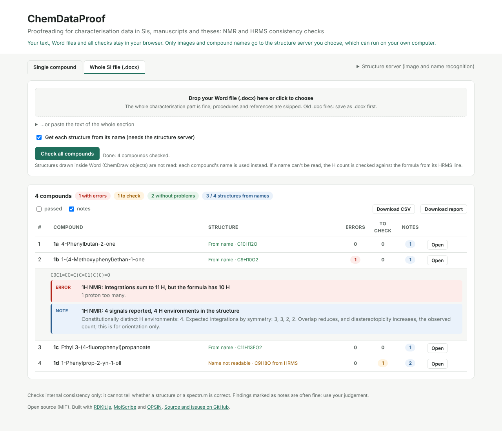
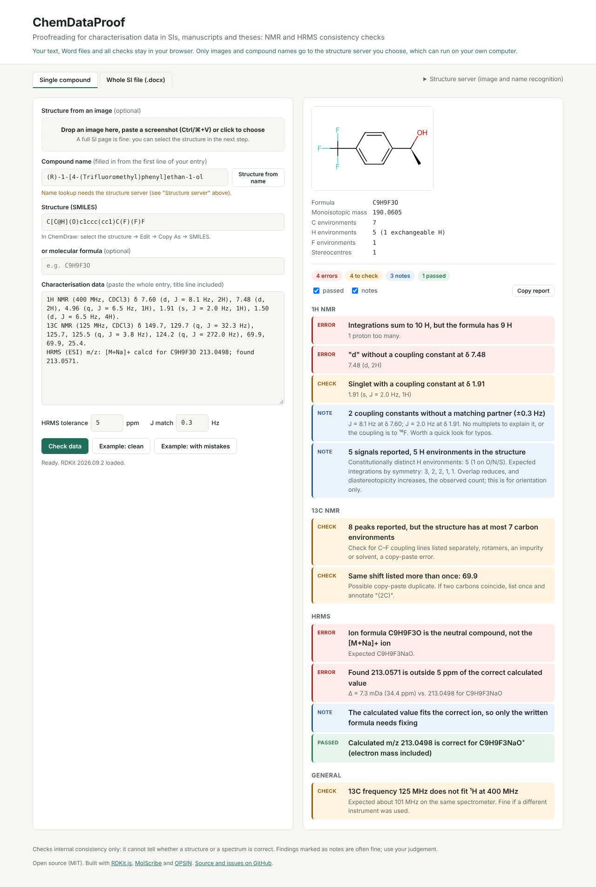

# ChemDataProof

**Proofreading for reported chemical characterisation data: catch the mistakes before reviewers do.**

[](https://github.com/sripatijana/chemdataproof/actions/workflows/test.yml)
[](LICENSE)

**Try it:** https://sripatijana.github.io/chemdataproof/

Paste a compound entry exactly as it appears in a Supporting Information file, a manuscript's experimental section or a thesis (title line, NMR and HRMS data), or upload a whole Word file. ChemDataProof reads the ¹H, ¹³C, ¹⁹F, ³¹P and HRMS data and flags anything that doesn't add up.

The structure can come from three sources, and ChemDataProof cross-checks them:

1. **The compound name.** It's read from the title line and converted with [OPSIN](https://github.com/dan2097/opsin). This is exact for systematic names.
2. **An image of the drawing.** You can paste a ChemDraw screenshot or a full SI page and drag a box around the molecule. It's read with [MolScribe](https://github.com/thomas0809/MolScribe), then shown next to your image for confirmation.
3. **SMILES** typed or pasted directly.

If the name and the drawing disagree (different compound, or R vs S), you are told.

**Whole SI files:** upload your Word file (.docx) and ChemDataProof splits the characterisation part into compounds, gets each structure from its name and checks every entry. You get **your own Word file back with margin comments** on each problem ("Please correct", "Please check", "Minor"), attached to the exact text, plus a report table you can download as CSV or HTML.



**Privacy:** the text, the Word file and all checks stay in your browser. Images and names go only to the structure server you choose, and you can run that server on your own computer.



## What it checks

| Section | Check | Level |
|---|---|---|
| ¹H NMR | Integrations add up to the H count of the formula (with an allowance for unobserved OH/NH/SH) | error / note |
| ¹H NMR | Multiplicity matches the number of J values (`d` without J, `s` with J, `dd` with one J, …) | error / warning |
| ¹H NMR | Every J value has a partner signal within ±0.3 Hz (adjustable) | note |
| ¹H NMR | Descending order, 2-decimal shifts, 1-decimal J values, plausible range | note |
| ¹H NMR | Number of signals vs. constitutionally distinct H environments | note |
| ¹³C NMR | Peak count vs. carbon environments from the structure (more peaks than environments is flagged) | warning / note |
| ¹³C NMR | Duplicate shifts, order, range, consistent decimals, C–F couplings reported for fluorinated compounds | warning / note |
| ¹⁹F / ³¹P | Peak count vs. F / P environments; data given for a compound without F / P | warning / error |
| HRMS | Ion formula = compound + stated adduct (`[M+H]+`, `[M+Na]+`, `[M−H]−`, `[M]+`, `[M+NH4]+`, `[M+2H]2+`, …) | error |
| HRMS | Calculated m/z is correct for the ion (with or without the electron mass, ⁸¹Br / ³⁷Cl isotopologues recognised) | error / note |
| HRMS | Found value within ±5 ppm (adjustable) of the correct calculated value | error |
| General | ¹³C / ¹⁹F / ³¹P frequency consistent with the ¹H frequency; same solvent across experiments | warning / note |
| Structure | Name (OPSIN) and drawn structure are the same compound, including stereochemistry | error / warning |
| Structure | Name can't be interpreted (often a typo in the name) | warning |
| Structure | Structure recognised from an image has not been confirmed | warning |

Salts are handled: for an azolium tetrafluoroborate, `[M]+` is matched against the cation.

## What it does *not* do

ChemDataProof checks whether reported data is **internally consistent**. It cannot tell you whether the structure is right or whether the spectrum shows what you claim. Expected peak counts come from constitutional symmetry, so:

- diastereotopic CH₂ protons, rotamers and diastereomer mixtures can give *more* signals than expected;
- overlapping signals and unobserved quaternary carbons give *fewer*.

That is why peak-count findings are warnings or notes, never errors. Use your judgement.

## Supported input styles

The parser tolerates the usual variations from Word, ChemDraw and PDF copy-paste:

```
1H NMR (400 MHz, CDCl3) δ 7.26 (dd, J = 8.0, 2.1 Hz, 1H), 3.80 (s, 3H, OCH3), 2.31–2.25 (m, 2H)
¹H NMR (500 MHz, DMSO-d₆): δ = 1.20 (2H, t, J = 7.1 Hz)
13C{1H} NMR (101 MHz, CDCl3) δ 158.0, 129.8 (2C), 124.1 (q, J = 272.1 Hz), 55.3
HRMS (ESI) m/z: [M+Na]+ calcd for C9H9F3NaO 213.0498; found 213.0495.
HRMS (ESI+): calcd for C10H13O2 [M+H]+: 165.0910, found: 165.0912.
```

If something in your style is not recognised, please [open an issue](https://github.com/sripatijana/chemdataproof/issues) with the example text.

## Whole SI file mode

The **Whole SI file (.docx)** tab reads a Word document in the browser (its XML, via [JSZip](https://stuk.github.io/jszip/)) and splits it into entries:

- A **title** is a short line that isn't a sentence, such as `4-Phenylbutan-2-one (1a)`. The label in brackets is shown separately.
- Everything from a title up to the next title that contains NMR or HRMS data belongs to that compound, even when it's split across several paragraphs.
- Procedures, yields and references are skipped.

Each compound's structure comes from its name via OPSIN (in one request). When a name can't be read, it's flagged, and the H count is checked against the formula from the HRMS line instead. Structures drawn inside Word (ChemDraw objects) aren't read. Click a row for details, or **Open** to move the entry into the single-compound view.

**Word file with comments.** After checking, **Download Word file with comments** returns your original document, otherwise unchanged, with a review comment on each problem:

- Each comment is anchored to the exact text (an ion label, a signal, a value), or to the whole spectrum for problems like an integration sum.
- A summary comment at the top counts the problems and lists the ones that recur across compounds, which are usually fixed with one find-and-replace.
- Notes that are obviously fine (an unobserved OH/NH, a coupling partner reported as a multiplet) stay on the web page and aren't written into the document. "Include minor points" switches the remaining presentation notes on or off.

## Image and name recognition (structure server)

Recognising images needs a deep-learning model (MolScribe, PyTorch) and names need OPSIN (Java). Neither can run inside a static page, so they live in a small companion server in [`structure-server/`](structure-server/). You can either:

- deploy it for free as a **Hugging Face Space** (Docker), or
- run it **on your own computer** for full privacy (`uvicorn app:app --port 7860`).

See [`structure-server/README.md`](structure-server/README.md). Then set its address in `js/config.js`, or under "Structure server" in the page. Without a server, everything except image and name recognition still works.

**About the confirmation step:** image recognition makes mistakes, especially with stereo wedges, abbreviations (Ts, Boc, Bpin), R groups and low-resolution screenshots. ChemDataProof therefore shows the recognised structure next to your image and keeps a warning in the report until you tick "Both drawings match". For best results, zoom in before taking the screenshot.

## Run locally

It's a static site with no build step:

```bash
git clone https://github.com/sripatijana/chemdataproof.git
cd chemdataproof
python3 -m http.server 8000      # then open http://localhost:8000
```

Tests (Node ≥ 18):

```bash
npm install
npm test
```

## Project layout

```
index.html            page
css/style.css         styles (light and dark mode)
js/app.js             UI
js/examples.js        demo inputs
js/core/formula.js    formula parsing, exact masses, adducts
js/core/parse.js      section splitting and NMR / HRMS parsers
js/core/structure.js  RDKit.js: formula, symmetry classes, environments
js/core/checks.js     all checks → findings
js/ocsr.js            image upload, cropping, recognition, confirmation
js/name.js            name extraction from the entry and OPSIN lookup
js/batch.js           whole-SI mode: per-compound checks, CSV/HTML report, Word export
js/core/docx.js       reading .docx paragraphs and writing anchored Word comments
js/core/document.js   splitting a section into compound entries
js/config.js          default structure-server address
tests/                node:test suite
structure-server/          FastAPI server: MolScribe (image) and OPSIN (name), with tests
```

The core modules have no browser dependencies, so they can also be used from Node scripts.

## Roadmap

- [x] Image → SMILES with a confirmation step
- [x] Name → SMILES and name/structure cross-check
- [ ] Find the structure on a page automatically (no manual box)
- [ ] Read a whole SI PDF: text from the PDF text layer (exact, no OCR) and every structure in it
- [ ] Draw the structure in the page (Ketcher / JSME)
- [x] Whole SI file (.docx): one report for every compound
- [ ] Highlight the offending text directly in the input
- [ ] Python package for scripted checks
- [ ] Elemental analysis and optical rotation checks

## Contributing

Bug reports with real (or anonymised) example text are the most useful contribution. Pull requests are welcome; please add a test in `tests/` for any new check.

## Citation

If ChemDataProof helps your work, please cite it using the metadata in [`CITATION.cff`](CITATION.cff).

## Author

Sripati Jana ([ORCID 0000-0001-7155-8384](https://orcid.org/0000-0001-7155-8384)), synthetic organic chemist. Licensed under MIT.
